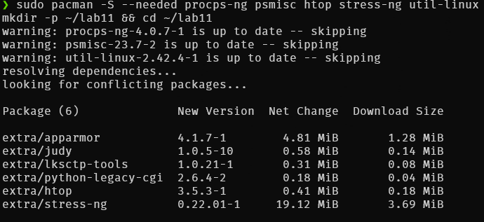
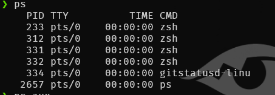
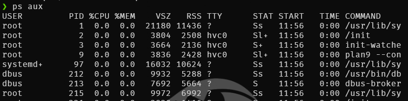
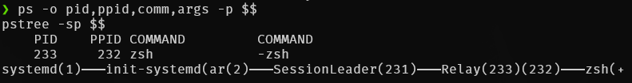
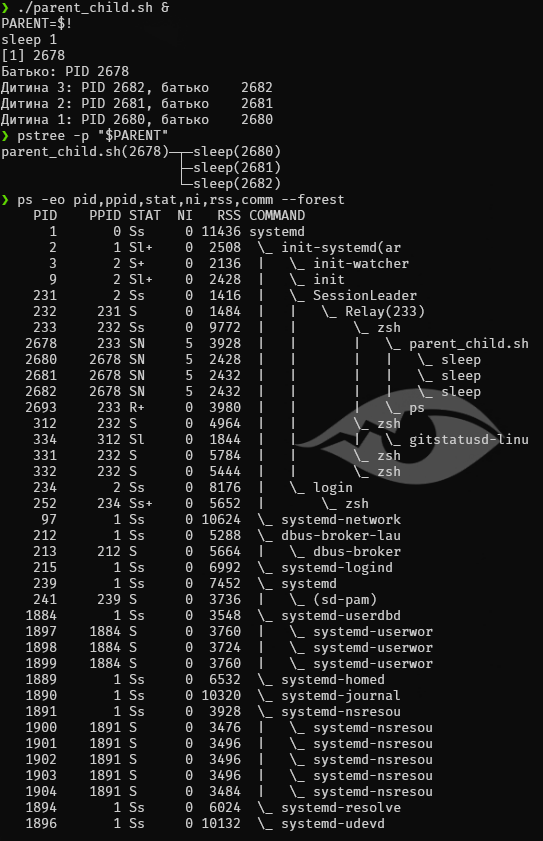

## Хід роботи

### 1. Підготовка робочого середовища

Підготував робоче середовище: встановив необхідні утиліти `htop`, `pstree`, `stress-ng`, `psmisc`, створив каталог `~/lab11` та підготував навчальні Bash-скрипти `cpu_load.sh` і `parent_child.sh`.




### 2. Перегляд процесів системи

Отримав перелік процесів за допомогою команд `ps`, `ps aux` і `ps -ef` та проаналізував відмінності між ними.





- `ps` без параметрів показує процеси поточного користувача, пов'язані з поточним терміналом.
- `ps aux` використовує синтаксис BSD і виводить список процесів системи з інформацією про використання CPU та пам'яті, стан процесу (`STAT`) і команду запуску.
- `ps -ef` використовує синтаксис System V і показує процеси з такими параметрами, як PID, PPID, UID, час запуску та термінал. На відміну від `ps aux`, ця команда не виводить відсотки використання CPU та пам'яті у стандартному наборі стовпців.

### 3. Дослідження дерева процесів

Побудував дерево процесів за допомогою команди `pstree -p` та визначив батьківські процеси поточного термінала. Поточна оболонка `zsh` мала PID 233.




Запустив скрипт `parent_child.sh` у фоновому режимі та перевірив створене дерево процесів.



Для визначення PID дочірніх процесів використав змінну `$BASHPID`. На відміну від `$BASHPID`, змінна `$$` у Bash зберігає PID початкової оболонки навіть усередині подоболонки, створеної конструкцією `( ... )`. Тому `$BASHPID` дає змогу отримати ідентифікатор поточного процесу Bash.

### 4. Дослідження параметрів процесу find

Відповідно до варіанта 19 дослідив процес `find`, який виконував сканування файлової системи. За допомогою команди `ps` та файлу `/proc/PID/status` перевірив ідентифікатори процесу, його стан, пріоритет, використання пам'яті та кількість потоків.


**Таблиця 1 – Результати дослідження процесу find (варіант 19)**

| Джерело / параметр  |  PID | PPID | Стан        |  NI |         Пам'ять | Кількість потоків |
| ------------------- | ---: | ---: | ----------- | --: | --------------: | ----------------: |
| `ps`                | 2733 |  233 | DN          |   0 |   9172 KB (RSS) |                 — |
| `/proc/2733/status` | 2733 |  233 | R (running) |   — | 9172 kB (VmRSS) |                 1 |

Показники стану процесу могли відрізнятися, оскільки команди зчитували інформацію в різні моменти часу. Стан `R` означає, що процес виконується або готовий до виконання, а `D` — що процес перебуває в непереривному очікуванні, зазвичай пов'язаному з операціями введення-виведення.

### 5. Керування процесами за допомогою сигналів

Дослідив керування процесом `find` за допомогою сигналів `SIGSTOP`, `SIGCONT` та `SIGINT`. Сигнал `SIGSTOP` призупиняє виконання процесу, `SIGCONT` відновлює його, а `SIGINT` надсилає запит на переривання.


Після надсилання `SIGSTOP` процес перейшов у призупинений стан, який у виводі `ps` позначається літерою `T`. Після надсилання `SIGCONT` він відновив виконання. Завершення процесу було ініційовано сигналом `SIGINT`.

### 6. Порівняння сигналів SIGTERM і SIGKILL

Порівняв дію сигналів `SIGTERM` та `SIGKILL` на прикладі скрипта `stubborn.sh`, який перехоплює сигнал `SIGTERM`.

Після надсилання `SIGTERM` скрипт виконав обробник сигналу й продовжив роботу. Це демонструє, що програма може перехоплювати та обробляти `SIGTERM`. Після надсилання `SIGKILL` процес було примусово завершено, оскільки цей сигнал не можна перехопити, заблокувати або ігнорувати.

### 7. Дослідження пріоритетів процесів

Запустив два процеси `cpu_load.sh` із різними значеннями `nice`, щоб порівняти їхні параметри за допомогою команди `ps`.

Отримані значення:

|  PID |  NI | PRI | %CPU | STAT |
| ---: | --: | --: | ---: | ---- |
| 2843 |   5 |  14 |  100 | RN   |
| 2844 |  15 |   4 |  100 | RN   |

У цьому запуску обидва процеси використовували близько 100% CPU. Значення `NI` становили 5 і 15, що відображає різні рівні пріоритету планування. Фактичне використання CPU залежить від доступних процесорних ресурсів, навантаження системи та параметрів запуску.

Також спробував змінити значення `nice` другого процесу командою `renice 0 -p PID`. Операція завершилася повідомленням `Permission denied`, оскільки звичайний користувач не мав необхідних прав для підвищення пріоритету процесу. У Linux зменшення значення `nice` зазвичай вимагає відповідних привілеїв.

### 8. Дослідження зомбі- та осиротілих процесів

Відтворив зомбі-процес і осиротілий процес, щоб дослідити їхні особливості.

**Зомбі-процес.** Запустив дочірній процес `sleep`, який завершився раніше за батьківський процес. Оскільки батьківський процес ще не отримав код завершення дочірнього процесу через `wait()`, у системі залишився запис про завершений процес зі станом `Z`, який відображався як `[sleep] <defunct>`.

**Осиротілий процес.** Запустив дочірній процес `sleep 120`, після чого завершив батьківський процес. Дочірній процес продовжив роботу, а його PPID змінився на 232, що було перевірено командою `ps`. Це демонструє механізм усиновлення осиротілих процесів у середовищі WSL.

### 9. Керування процесами у Windows

Виконав аналогічні операції керування процесами в Windows за допомогою PowerShell. Переглянув процеси з найбільшою робочою множиною пам'яті (`WS`), визначив ідентифікатор батьківського процесу `notepad.exe` через `Win32_Process`, змінив пріоритет процесу на `BelowNormal` та завершив його командою `Stop-Process`.

### 10. Індивідуальне завдання: дослідження стану процесу під час дискових операцій

Для виконання індивідуального завдання варіанта 19 створив Bash-скрипт `monitor_find.sh`, який запускає процес `find` у фоновому режимі та періодично перевіряє його стан. Скрипт з інтервалом 0,5 секунди виводить час спостереження, PID, стан процесу, значення `nice`, обсяг використаної пам'яті та кількість потоків із `/proc/PID/status`.


Під час спостереження було зафіксовано перехід процесу між станами `R` та `D`. Стан `R` означає, що процес виконується або готовий до виконання, а стан `D` вказує на непереривне очікування, зазвичай пов'язане з операціями введення-виведення. Отже, моніторинг продемонстрував, що стан процесу може змінюватися під час сканування файлової системи.

## Відповіді на контрольні питання

### Достатній рівень

**1. Що означає стан процесу D?**

Стан `D` (uninterruptible sleep) означає, що процес перебуває в непереривному очікуванні, зазвичай під час операції введення-виведення. Сигнали можуть бути надіслані такому процесу, але навіть `SIGKILL` не забезпечує негайного завершення, поки процес залишається в цьому стані. Після виходу з очікування ядро може обробити сигнал і завершити процес.

**2. Чому збільшення значення nice знижує пріоритет процесу, а зменшення підвищує його?**

Значення `nice` впливає на пріоритет процесу під час планування CPU. Збільшення `nice` знижує відносний пріоритет процесу, тоді як зменшення підвищує його. Звичайний користувач зазвичай може збільшувати значення `nice` власних процесів, але для зменшення значення, що підвищує пріоритет, потрібні відповідні привілеї.

**3. Чому зомбі-процес не можна завершити командою kill?**

Зомбі-процес уже завершив виконання, тому сигнал `kill` не може завершити його повторно. У таблиці процесів залишається запис із кодом завершення, який батьківський процес ще не отримав. Для видалення цього запису батьківський процес має викликати `wait()` або відповідний системний виклик. Якщо батьківський процес завершується, зомбі переходить під опіку відповідного процесу-всиновителя, який може отримати код завершення.

**4. Що таке осиротілий процес?**

Осиротілий процес — це дочірній процес, батьківський процес якого завершився раніше за нього. Дочірній процес продовжує виконуватися, а його новим батьківським процесом стає процес-всиновитель. Залежно від середовища це може бути системний `init`, `systemd` або інший процес, налаштований як subreaper.

**5. Як вивести п'ять процесів із найбільшим використанням пам'яті?**

Для виведення п'яти процесів із найбільшим обсягом резидентної пам'яті можна використати команду:

```bash
ps -eo pid,ppid,cmd,%mem,rss --sort=-rss | head -n 6
```

Параметр `--sort=-rss` сортує процеси за спаданням резидентної пам'яті, а `head -n 6` виводить заголовок і п'ять перших процесів.

**6. У чому різниця між командами kill, killall і pkill?**

- `kill` надсилає сигнал процесу за його PID.
- `killall` надсилає сигнал процесам за назвою виконуваного файла.
- `pkill` шукає процеси за назвою, а з параметром `-f` — за повним командним рядком.

Наприклад, `kill -TERM 1234` надсилає `SIGTERM` процесу з PID 1234, `killall firefox` — процесам із назвою `firefox`, а `pkill -f 'sleep 300'` шукає процеси, у командному рядку яких є відповідний шаблон.

**7. Як переглянути дерево процесів і визначити батьківський процес?**

Дерево процесів можна переглянути командами:

```bash
pstree -p
ps -eo pid,ppid,comm --forest
```

Щоб визначити батьківський PID конкретного процесу, можна виконати:

```bash
ps -o ppid= -p PID
```

Також інформацію про батьківський процес можна знайти у файлі `/proc/PID/status` у полі `PPid`.

**8. Яку інформацію містить каталог /proc/PID?**

Каталог `/proc/PID` містить віртуальні файли з інформацією про процес. Наприклад:

- `status` — стан процесу, UID/GID, використання пам'яті та кількість потоків;
- `cmdline` — командний рядок запуску процесу;
- `fd/` — відкриті файлові дескриптори;
- `environ` — змінні оточення процесу за наявності відповідних прав доступу;
- `maps` — карту областей віртуальної пам'яті процесу.

Файли `/proc` дають змогу отримувати інформацію безпосередньо з інтерфейсу ядра Linux. Їхній вміст може змінюватися протягом виконання процесу, а доступ до окремих даних залежить від прав користувача та налаштувань системи.

## Висновок

Під час виконання лабораторної роботи опанував методи перегляду та керування процесами в Linux і Windows. Дослідив відмінності між командами `ps`, `ps aux`, `ps -ef` і `pstree`, навчився визначати PID та PPID процесів, переглядати їхній стан і використання пам'яті.

На практиці перевірив дію сигналів `SIGTERM`, `SIGKILL`, `SIGSTOP`, `SIGCONT` та `SIGINT`, дослідив вплив значення `nice` на пріоритет процесу, а також відтворив зомбі- й осиротілий процеси. Для індивідуального завдання варіанта 19 створив скрипт `monitor_find.sh`, який відстежує параметри процесу `find`. Під час сканування файлової системи було зафіксовано зміну стану процесу між `R` та `D`, що дало змогу дослідити його поведінку під час виконання операцій введення-виведення.
